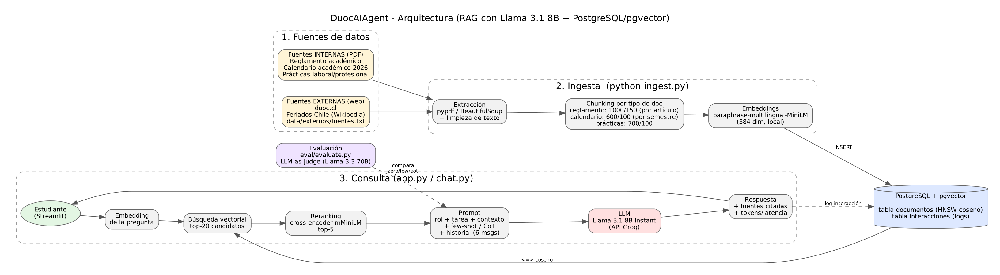

# DuocAIAgent · Orientador Duoc

Agente RAG que orienta a estudiantes recién ingresados a **Duoc UC** sobre prácticas (laboral y profesional),
calendario académico y reglamento académico.

Proyecto de la asignatura **Ingeniería de Soluciones con IA (ISY0101)** · Evaluación Parcial N°1.
Integrantes: Joaquin Herrera y Roberto Bustos.

## ¿Qué problema resuelve?

Los estudiantes de primer y segundo año no saben dónde buscar información básica: cuándo empiezan las clases,
cuántas horas dura la práctica laboral, qué pasa si reprueban un ramo, etc. Esa información existe, pero está
repartida en documentos largos (el reglamento tiene 38 páginas). El agente responde en lenguaje natural,
**solo con información de documentos oficiales** y citando la fuente.

## Arquitectura



| Componente | Tecnología | Por qué |
|---|---|---|
| LLM | `llama-3.1-8b-instant` vía **Groq** | Modelo open source, rápido y gratis (el mismo que vimos en la clase 1.2) |
| Embeddings | `paraphrase-multilingual-MiniLM-L12-v2` (sentence-transformers) | Multilingüe, corre local, no necesita API key |
| Base vectorial | **PostgreSQL + pgvector** (índice HNSW coseno) | SQL estándar, guarda vectores y logs en la misma BD |
| Reranking | cross-encoder `mmarco-mMiniLMv2-L12-H384-v1` | Mejora el orden de los chunks (clase 1.3), versión multilingüe |
| Ingesta | pypdf, BeautifulSoup, LangChain text splitters | Fuentes internas (PDF) y externas (web) |
| UI | Streamlit | Chat simple con fuentes, tokens y latencia |
| Evaluación | LLM-as-judge con `llama-3.3-70b-versatile` | Juez más grande que el modelo evaluado |
| Contenedores | Docker + docker compose | Levanta BD + app con un comando |

Más detalle de las decisiones de diseño en [docs/decisiones.md](docs/decisiones.md).

## Estructura del proyecto

```
├── DuocAiAgent.ipynb       # Notebook: todo el pipeline paso a paso (ingesta, retrieval, prompts, evaluación)
├── app.py                  # App Streamlit (chat)
├── chat.py                 # Chat por consola
├── ingest.py               # Carga los documentos a PostgreSQL
├── prompts/prompt.py       # Prompts: zero-shot, few-shot y chain-of-thought
├── src/
│   ├── config.py           # Variables de entorno
│   ├── ingesta/ingest.py   # Extracción, limpieza, chunking y embeddings
│   ├── retrieval/retrieval.py  # Búsqueda en pgvector + reranking
│   ├── generate/generate.py    # Arma el prompt, llama al LLM y guarda la interacción
│   └── utils/              # Clientes de Groq, embeddings y PostgreSQL
├── data/
│   ├── internos/           # PDFs institucionales (fuentes internas)
│   └── externos/fuentes.txt    # URLs (fuentes externas)
├── eval/
│   ├── dataset.json        # Preguntas + respuesta esperada
│   ├── evaluate.py         # Evaluación de las 3 versiones de prompt
│   └── resultados/         # Evidencia de las corridas
├── tests/                  # Tests con pytest
├── docs/                   # Diagrama, decisiones e informe
└── notebooks/DuocAiAgent_v1.ipynb  # Primera versión (Colab + MongoDB), se deja como historial
```

## Cómo ejecutarlo

> Paso a paso detallado (Windows/Mac/Linux, con Jupyter): **[docs/INSTRUCTIVO.md](docs/INSTRUCTIVO.md)**

### 1. Requisitos
- Docker y Docker Compose (opción recomendada), o Python 3.11 + PostgreSQL 16 con pgvector.
- Una API key de Groq: https://console.groq.com/keys

### 2. Variables de entorno

```bash
cp .env.example .env
# editar .env y pegar la GROQ_API_KEY
```

El `.env` está en el `.gitignore`, **nunca se sube al repo**.

### 3. Documentos

Los 3 PDFs ya vienen en `data/internos/` (ver [data/internos/README.md](data/internos/README.md)).
Las URLs externas están en `data/externos/fuentes.txt`.

### 4a. Con Docker (recomendado)

```bash
docker compose up -d --build          # levanta PostgreSQL+pgvector y la app
docker compose exec app python ingest.py   # carga los documentos (solo la primera vez)
```

Abrir http://localhost:8501

### 4b. Sin Docker (local)

```bash
python -m venv .venv && source .venv/bin/activate   # en Windows: .venv\Scripts\activate
pip install -r requirements.txt

# solo la BD en docker (o usar una PostgreSQL propia y cambiar DATABASE_URL)
docker compose up -d db

python ingest.py            # --reset para borrar y volver a cargar
streamlit run app.py        # o: python chat.py  para usarlo por consola
jupyter notebook DuocAiAgent.ipynb   # o el notebook paso a paso
```

> Si usan una base en la nube (Supabase, Neon, etc.) basta con poner su connection string en `DATABASE_URL`
> y correr la opción 4b sin el `docker compose up -d db`. La extensión `vector` se crea sola.

## Pruebas

### Tests automáticos (pytest)

```bash
docker compose up -d db
pytest -v
```

Prueban la limpieza del texto de pypdf, el chunking por tipo de documento, los prompts, la búsqueda vectorial
en PostgreSQL y el flujo completo de generación (con un LLM falso para no gastar tokens).
Si no hay PostgreSQL disponible, los tests de BD se saltan. Última corrida: [docs/evidencia_tests.txt](docs/evidencia_tests.txt).

### Evaluación del RAG

```bash
python -m eval.evaluate                       # compara zero_shot, few_shot y cot
python -m eval.evaluate --versiones few_shot  # solo una versión
```

Usa las preguntas de `eval/dataset.json` y mide:
- **hit_fuente**: si el retrieval trajo un chunk de la fuente correcta.
- **correctitud**: si la respuesta coincide con la esperada (juez LLM, 0 a 1).
- **fundamentación**: si la respuesta está respaldada por el contexto, o sea que no inventa (juez LLM, 0 a 1).

Los resultados quedan en `eval/resultados/` (JSON + tabla en markdown) y se usan como evidencia en el informe.

## Trazabilidad

Cada pregunta queda registrada en la tabla `interacciones` (pregunta, respuesta, fuentes usadas con su score,
versión del prompt, modelo, tokens y latencia). Para revisarlas:

```sql
SELECT creado_en, pregunta, prompt_version, fuentes, latencia_ms FROM interacciones ORDER BY creado_en DESC LIMIT 20;
```

## Limitaciones conocidas

- Llama 3.1 8B es un modelo chico: a veces no sigue al 100% el formato o mezcla fechas cuando hay muchos chunks.
- El calendario es del año 2026; hay que reemplazar el PDF cada año y correr `python ingest.py --reset`.
- El tier gratis de Groq tiene límite de requests por minuto (la evaluación hace pausas por eso).
- Las páginas web externas pueden cambiar o caerse; la ingesta las salta con un warning.
